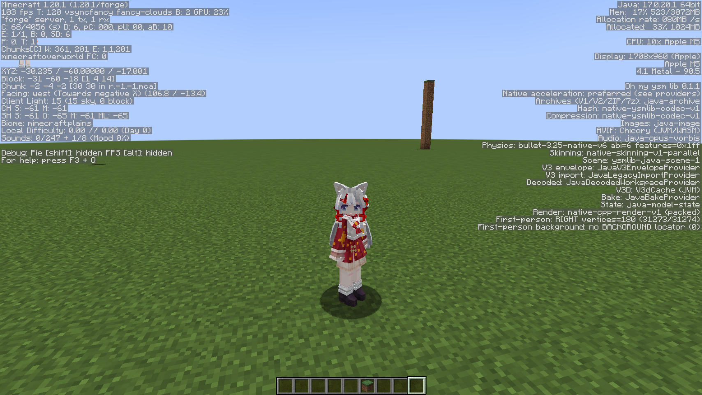
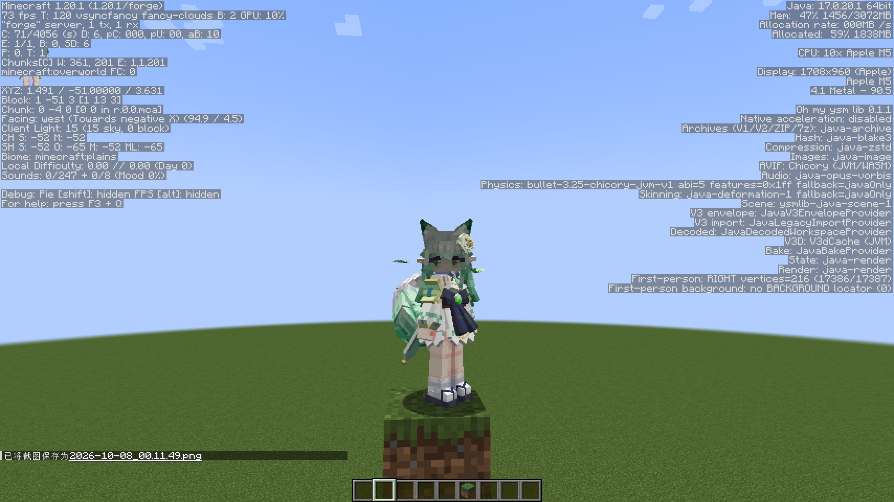
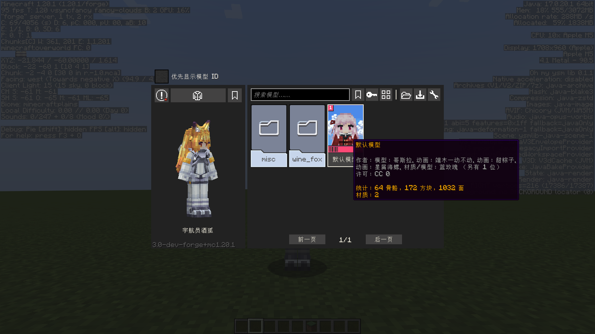
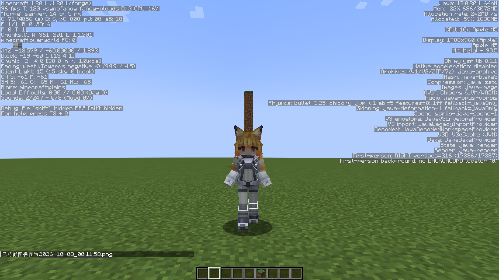

# Oh My YSM · macOS 实机验证（Apple Silicon M5 / macOS 26.6）

> **English summary** — First real-hardware verification of [Oh My Yes Steve Model](https://github.com/AndreaFrederica/OhMyYesSteveModel) (`ysm-3.0-dev` + `Oh my ysm lib 0.1.1`, Minecraft 1.20.1 / Forge 47.4.3) on an Apple M5 Mac running macOS 26.6. Both the pure-JVM baseline and the self-built native accelerators (codec / render / physics / skinning, macOS arm64) work in game, with textures, animation and model switching verified. Two small native build fixes for macOS are included in [`patches/`](patches/patch-macos-native.diff). The run also found three platform-independent bugs that only show up with the production JARs: the dedicated server fails to start because common code uses LWJGL `MemoryUtil`, a resource reload (F3+T / language change) hangs forever on the loading screen, and built-in pack descriptors fail to load from the mod JAR. Full report below (Chinese, matching upstream docs).

| 项目 | 内容 |
|---|---|
| 被测项目 | [AndreaFrederica/OhMyYesSteveModel](https://github.com/AndreaFrederica/OhMyYesSteveModel)；构建分支 [AndreaFrederica/YesSteveModel `feature/v3d-decoded-cache`](https://github.com/AndreaFrederica/YesSteveModel/tree/feature/v3d-decoded-cache) @ `25ae5414` |
| 测试与报告 | **[TianjiMeteor](https://github.com/tianjimeteor)**（由 Claude Code 协助执行构建、日志分析与整理） |
| 日期 | 2026-10-07 ～ 2026-10-08 |
| 状态 | 社区自发验证，非官方；上游未关联、未背书 |

<p>


</p>
<p>


</p>

左上：native 加速模式的 F3；右上：纯 JVM 模式的 F3；左下：⌥+Y 模型界面；右下：走路动画。

> 「通过」只表示在下述单一环境、单一场景下观察到预期行为，不代表 macOS 已完成验收，也不扩大上游[支持状态](https://github.com/AndreaFrederica/YesSteveModel/blob/feature/v3d-decoded-cache/docs/status/support-and-verification.md)中的承诺。

## 结论摘要

- **纯 JVM 基线在 macOS arm64 上可用**：模组加载、F3 provider 显示、内置模型贴图、动画、服务器指令与 GUI 内切换模型均正常，没有出现官方 YSM 1.x 在 Mac 上的紫黑贴图问题。
- **自建 native 加速在 macOS arm64 上可用**，需要两处小的构建修补（见 M1、M2）。修补后 native 自测 5/5、JNI 差分 codec 3/3、render 5/5、physics 57/57、skinning 5/5 全部通过。游戏内 F3 显示 `Hash/Compression: native-ysmlib-codec-v1`、`Render: native-cpp-render-v1 (packed)`、`Physics: bullet-3.25-native-v6`、`Skinning: native-skinning-v1-parallel`，与 build.md 的验收标准一致。
- **发现 3 个与平台无关、只在生产发行包里出现的问题**（开发环境 `runClient/runServer` 难以复现）：
  1. **专用服务器无法启动**：通用代码依赖客户端专有的 LWJGL `MemoryUtil`（X1）。
  2. **资源重载（F3+T / 切换语言）永久卡在 Mojang 加载界面**：远程模型的贴图重载会读取已关闭的缓冲区（X2）。
  3. **内置模型包描述读取失败**：jar 内 union 文件系统不支持 `FileChannel.open`（X3）。
- 另有 macOS 分发相关问题（libc++ 动态依赖、`minos`、Gatekeeper 隔离）、构建文档缺口和 3 处测试的路径假设问题，详见下文。

## 环境

| 项目 | 值 |
|---|---|
| 硬件 | Apple M5（10 核）、16 GB 内存 |
| 系统 | macOS 26.6.2（25G83）；Command Line Tools 27.0（`MacOSX.sdk` → `MacOSX27.0.sdk`，另装有 26.5 SDK） |
| 源码 | `AndreaFrederica/YesSteveModel` 分支 `feature/v3d-decoded-cache` @ `25ae5414`（2026-10-07） |
| JDK | Homebrew OpenJDK 17.0.20.1（构建与运行）；21.0.12.1（仅作 Gradle toolchain，见 B1） |
| 构建工具 | Gradle Wrapper 8.12；Pixi 0.81.0；Meson 1.12.1；conda-forge clang 19.1.7、ld64 956.6、libcxx 23.1.2（headers 19.1.7） |
| 游戏 | Minecraft 1.20.1 + Forge 47.4.3；Prism Launcher 11.1.1；GL：`Apple M5, 4.1 Metal - 90.5`；LWJGL 3.3.1 |
| 安装的 Mod | 仅 `ysm-3.0-dev-forge+mc1.20.1.jar` 和 `ysm-runtime-forge-0.1.1.jar`（build.md 写的是 0.1.1，任务描述里的 0.1.0 已过时） |
| 服务器 | Forge 1.20.1-47.4.3 专用服务器，127.0.0.1:25580，离线模式，超平坦世界 |

## 构建

| 步骤 | 命令 | 结果 |
|---|---|---|
| 前置 | `./gradlew -p runtime build` | ✅ 5m26s，194 任务；runtime 测试 418 通过 / 0 失败 / 69 跳过（跳过的全部是需显式指定库路径的 Native* 测试） |
| 本体 | `./gradlew build -Pysm.fast_run=true` | ❌ 按文档原样执行失败，原因依次见 B1、B2、B3、T1。补齐后 ✅：675 测试，0 失败，13 跳过 |
| native | `pixi install --locked && pixi run test`（`runtime/native`） | ❌ 编译失败（M1）。修补后 4/5，`physics-smoke` 失败（M2）。再修补后 ✅ 5/5 |
| JNI 差分 | `nativeTest -PcodecLibrary=… -PrenderLibrary=…` | ❌ 配置缓存报错（B3）；加 `--no-configuration-cache` 后 ✅ codec 3/3、render 5/5 |
| JNI physics/skinning | `:ysm-runtime-native-physics:test :ysm-runtime-native-scene:test -Dysm.native.physics.library=… -Dysm.native.skinning.library=…` | ✅ physics 57/57（`-Xcheck:jni`）、scene 5/5 |

本机最终可用的本体构建命令（含本机网络代理，与上游无关）：

```bash
./gradlew build -Pysm.fast_run=true \
  -Porg.gradle.java.installations.paths=/opt/homebrew/opt/openjdk@21/libexec/openjdk.jdk/Contents/Home \
  --no-configuration-cache
# 另需 JAVA_TOOL_OPTIONS=-Djava.io.tmpdir=$(cd "$TMPDIR" && pwd -P) 才能让 T1 的 6 个测试通过
```

发行包 SHA-256：

```
5fb5ac0484c97ce69da0d8a5e767d761663365a9f66fe11ddba3f8645b43a093  ysm-3.0-dev-forge+mc1.20.1.jar
ff14c7d7512580fa32a70a75fc9eeabc3b9ae2646dc99f03ae4bfa727a0df9d0  ysm-runtime-forge-0.1.1.jar
3001fcae0b7f8054f8b2be6d5aa2ad34cde8d8fd635931ec8284abb9ba69a507  libysmlib_codec.dylib     (自包含版本，见 M3)
bfc347c60a3e5a931227f39ce7b8d98399d21c8d1eb4eb40eaa435e8a2d12a09  libysmlib_render.dylib
b1084ca16790fa565d7eef25642f693ea4d78c90c6216a2fd04d2f33ebb39e11  libysmlib_physics.dylib
e027fff90355be7e47fe85ae0831107f0823b97a1458369f1e3e21a22ef1134f  libysmlib_skinning.dylib
```

## 实机验证矩阵

客户端通过 Prism 启动，连接上述专用服务器（服务器依赖 X1 的诊断性绕过才能启动）。native 库放在 `<游戏目录>/ysmlib/natives/macos-arm64/`；纯 JVM 通过 `-Dysm.runtime.javaOnly=true` 强制。

| 能力 | 纯 JVM | 自建 native | 证据 |
|---|---|---|---|
| 模组加载 / Forge 联机握手 | ✅ | ✅ | `Connected to a modded server`；日志 `19/21/22-client-*.log` |
| F3 provider 显示 | ✅ `Native acceleration: disabled`；Hash `java-blake3`、Compression `java-zstd`、Physics `bullet-3.25-chicory-jvm-v1 … fallback=javaOnly`、Skinning `java-deformation-1`、Render `java-render` | ✅ `preferred`；Hash/Compression `native-ysmlib-codec-v1`、Physics `bullet-3.25-native-v6 abi=6`、Skinning `native-skinning-v1-parallel`、Render `native-cpp-render-v1 (packed)`、State `java-model-state` | `screenshots/jvm/2-f3-jvm-full.png`、`screenshots/native/8-f3-native-full.png` |
| native 库实际加载 | — | ✅ 4 个 dylib 均映射进客户端进程 | `17-native-client-loaded-dylibs.txt` |
| 内置模型贴图 | ✅ | ✅ 无紫黑贴图 | `screenshots/native/1～3`，`screenshots/jvm/1、3` |
| 动画 | ✅ 走路迈步摆臂 | ✅ HUD 小人头发、尾巴、耳朵逐帧变化 | `screenshots/jvm/4-walk-03_astronaut.png`，`screenshots/native/3～5`（HUD 小人姿势逐张不同） |
| 服务器指令切换模型 `/ysm model set` | ✅ → `wine_fox/03_astronaut` | ✅ → `wine_fox/22_elf` | `screenshots/jvm/3-switched-to-03_astronaut.png`、`screenshots/native/3-switched-to-22_elf.png` |
| GUI 切换模型（⌥+Y） | ✅ 中文界面、预览、切换请求均正常 | 未直接测（GUI 中选择的模型在随后的 native 轮次中正常渲染） | `screenshots/jvm/5-model-gui.png`；日志 `Sending model selection request` |
| 模型选择跨重连保留 | ✅ | ✅ | `screenshots/jvm/1-front-22_elf.png` |
| 资源重载（F3+T / 切换语言） | ❌ 卡死（X2） | ❌ 卡死（X2） | `20-client-reload-hang-jstack-*.txt`、`21-client-jvm-run.log` |
| 专用服务器（生产发行包） | ❌ 启动失败（X1） | ❌ 同左 | `14-server-native-FAILED.log` |
| 内置包 `misc/`、`wine_fox/` 描述 | ❌ 名称、图标缺失（X3） | ❌ 同左 | 服务器与客户端日志；`screenshots/jvm/5-model-gui.png` 中两个文件夹为通用图标 |
| 单人（集成服务器） | 未测 | 未测 | — |

冷启动的模型目录扫描：客户端 24.8 s、服务器 18.5 s；有缓存时 2.7～4.1 s（27 个模型，2 个错误均为 X3）。这不是性能测试，只作参考。

## 发现的问题

按影响从大到小排序。「平台」一栏标为「全部」的问题与 macOS 无关，只是由这次生产发行包实测发现的。

### X1 生产专用服务器启动失败：通用代码依赖 LWJGL（平台：全部，严重）

- **现象**：只装两个发行 JAR 的 Forge 专用服务器在 `CommonEvent` 的延迟任务里抛出 `ClassNotFoundException: org.lwjgl.system.MemoryUtil`，随后 `Failed to start the minecraft server`。
- **原因**：LWJGL 只随客户端分发。以下非 `client` 包的类直接 import `org.lwjgl.system.MemoryUtil`（`memAddress`、`memCopy`、`memByteBuffer`）：`buffer/NativeNioBuffer`、`buffer/NativeBuffer`、`buffer/MappedFileBuffer`、`network/forge/ForgeUniBufferIO`、`natives/image/Image`、`natives/image/ImageEncoder`、`natives/render/BonePoseView`、`natives/render/NativeBakedModel`。首个触发点：`BuiltinModelCatalog.generateDefault → … → Zstd.output → NativeNioBuffer.allocate`。开发环境的 `runServer` classpath 带有 LWJGL，所以发现不了。
- **佐证**：把 `lwjgl-3.3.1.jar` 和 macOS natives jar 追加到 `-DlegacyClassPath` 后，同一服务器 8.8 s 正常启动，并完成后续全部联机测试（`15-server-diag-lwjgl.log`）。这只是诊断手段，不建议作为修复。
- **建议**：在通用代码里提供一个不依赖 LWJGL 的直接内存工具（例如由前置提供，或复用已有的 `UnsafeUtil`：通过 `Buffer.address` 字段偏移取地址，用 `Unsafe.copyMemory` 复制，用 JNI `NewDirectByteBuffer` 或现有 native 包装地址）；客户端专用路径可以继续用 LWJGL。另外建议在发行验收里加一个「只用 Forge installer 装出的真实服务器 + 两个发行 JAR」的冒烟测试。

### X2 资源重载永久卡在加载界面（平台：全部，严重）

- **复现**：联机后由服务器下发模型（远程模型），在游戏中按 F3+T，或在选项里切换语言。纯 JVM 与 native 模式各复现 1 次，共 2 次中 2 次（native 模式切换语言、JVM 模式按 F3+T）。
- **现象**：日志出现 `Model lazy resource failed … path=wine_fox/03_astronaut stage=TEXTURE resource=player/skin/uv`，原因是 `IllegalStateException: Buffer is closed`（`RemoteModelContent$ReceivedChunkDataSource.readStoredVerified` → `ArrayBuffer.copy`）。之后 Mojang 加载界面永远不消失；线程栈显示所有 Worker 空闲，渲染线程正常画帧。
- **原因链**：原版 `TextureManager.reload` 在渲染线程上对每个已注册贴图执行 `reset → register → loadTexture`，全部完成后才执行 `cf.complete(null)`。`CustomPBRTextureSet.load(...)` 在 `catch (IOException | RuntimeException)` 中把 `RuntimeException` 原样重新抛出；原版 `loadTexture` 只把 `IOException` 降级为缺失贴图，其他 `Throwable` 都会构造 CrashReport（日志里紧跟着的 OSHI `hw.cpufrequency` 警告就是构造它的痕迹）并抛出 `ReportedException`。这个异常被 `thenAcceptAsync` 吞掉，`cf` 永远不会完成。
- **建议**：(1) `CustomPBRTextureSet.load` 把 `RuntimeException` 包装成 `IOException` 再抛出，最差也只会退化为缺失贴图，不会卡死；(2) 根因是远程模型接收到的 chunk 缓冲区在首次上传后就被释放，但贴图对象仍然持有指向它的数据源。重载时要么保留或重新取得数据，要么跳过重新上传、沿用已上传的 GPU 贴图。

### X3 内置模型包描述在发行 JAR 中读取失败（平台：全部，中）

- **现象**：服务器和客户端启动时都报 `Model catalog source failed root=BUILTIN source=wine_fox/`（以及 `misc/`），`UnsupportedOperationException` 来自 `FileSystemProvider.newFileChannel`。模型本身仍能加载（`models=27 errors=2`），但模型 GUI 里这两个包显示为通用文件夹图标和原始目录名，左上角出现错误红点。
- **原因**：`ModelPackScanner.scan` → `ModelHashing.blake3(Path)` 对 `ysm-pack.png` 调用 `FileChannel.open`。该方法已经为不支持 `map()` 的文件系统准备了退回路径，但 Forge union / jar 文件系统在 `FileChannel.open` 这一步就会抛出异常，而这一步在那个 `try` 之外。
- **建议**：同样捕获 `FileChannel.open` 抛出的 `UnsupportedOperationException`，然后用 `Files.newInputStream` 走有界的流式哈希。

### M1 macOS native 编译失败：`INFINITY` 未定义（平台：macOS，已验证修复）

- **现象**：Bullet 的 `btMLCPSolver.cpp`、`btDantzigLCP.cpp`、`btMultiBodyMLCPConstraintSolver.cpp` 报 `use of undeclared identifier 'INFINITY'`。
- **原因**：macOS 26 及以上的 SDK 在 `__has_feature(modules)` 为真时（严格的 `-std=c++20` 会触发）不再自己定义 `INFINITY`，改用 `__need_infinity_nan` 向 `<float.h>` 索取。conda-forge clang 19 的 `float.h` 不支持这个约定（LLVM 20.1、21.1 也不支持，main 分支已支持），而且在严格 C++ 模式下不定义 `INFINITY`。`gnu++20`、`c++17` 都不受影响；26.5 SDK 与 27.0 SDK 表现相同。
- **修复**（[`patches/patch-macos-native.diff`](patches/patch-macos-native.diff)）：在 `src/math/ysm_bullet_math.h`（不在 `source.json` 的校验范围内，且已被 patched `btScalar.h` 最先包含）的 `#include <math.h>` 之后加上 `#ifndef INFINITY / #define INFINITY (__builtin_inff()) / #endif`。

### M2 `physics-smoke` 在 macOS arm64 上与 WASM 基准不一致：Bullet 的 Apple NEON 路径（平台：macOS，已验证修复）

- **现象**：`physics_test.cpp:54` 断言失败。逐值对比发现，第 50 和第 60 步碰撞后的横向残差（约 1e-6～2e-5）**数值大小与基准逐位相同，但符号相反**，其中 4 个超出 1e-5 容差（`05-physics-smoke-deviation.txt`）。
- **原因**：`btScalar.h` 在 `__APPLE__ && __ARM_NEON__ && __clang__` 时会定义 `BT_USE_NEON` 和 `BT_USE_SIMD_VECTOR3`。`meson.build` 用 `-D__BT_DISABLE_SSE__` 让 MSVC 保持标量路径（注释说明了「与 WASM 同一标量求解路径」），但这个宏关不掉 Apple 的 NEON 分支。Linux arm64 走的是非 Apple 分支，不受影响。
- **验证**：用 `-U__ARM_NEON__` 重新编译 Bullet 和 physics 后，所有值与 WASM 基准逐位一致（`06-physics-smoke-noneon.txt`）。
- **修复**：在 `meson.build` 中，`host_machine.system() == 'darwin'` 时对 `physics_args` 追加 `-U__ARM_NEON__`（同一个 diff）。

### M3 macOS dylib 不自包含，且最低系统版本高于基线（平台：macOS，已验证修复配方）

- **现象**（默认 `pixi run test` 产物，`08-dylib-deps.txt`）：physics、render、skinning 动态链接 `@rpath/libc++.1.dylib`，`LC_RPATH` 是构建机上的绝对路径 `…/.pixi/envs/default/lib`；4 个库的 `minos` 都是 16.0。在玩家的 Mac 上前者会导致 `dlopen` 失败、静默回退到 JVM；后者高于产品基线 macOS 14.5，违反 `BC.native-distribution-is-self-contained` 和 `BC.minimum-platform-baselines`。
- **已验证配方**（`09-native-static-variant.log`、`10-dylib-deps-static.txt`）：

  ```bash
  MACOSX_DEPLOYMENT_TARGET=14.5 LDFLAGS="-nostdlib++ $CONDA_PREFIX/lib/libc++.a -lc++abi" \
    pixi run python tools/build.py configure --build-dir build-static
  pixi run meson compile -C build-static && pixi run meson test -C build-static
  ```

  得到 `minos 14.5`，依赖只剩 `libSystem` 和系统自带的 `/usr/lib/libc++abi.dylib`，5/5 测试通过；游戏内使用的就是这一版本（另外用 `install_name_tool -delete_rpath` 去掉了无用的构建机 rpath，并重新做了 ad-hoc 签名）。`libc++abi` 是否算「libc 伴生系统库」请维护者裁定；如果不算，需要额外的静态 abi 库。

### M4 Gatekeeper 会拦截下载来的 ad-hoc 签名 dylib（平台：macOS，风险）

- 给 dylib 副本加上 `com.apple.quarantine` 属性（模拟从浏览器下载）后，`System.load` 失败：`library load disallowed by system policy`，系统同时弹出「Apple 无法验证 … 是否包含恶意软件」。去掉该属性后可以正常加载。
- **影响**：如果 macOS native 以 zip 形式分发，玩家解压后加速会被拦下并回退 JVM（游戏不会崩溃）。**建议**：长期做法是 Developer ID 签名加公证；在此之前，可以在 build.md 的安装步骤里加一条玩家自行执行的命令，清除运行库目录的隔离属性：

  ```bash
  xattr -cr "<游戏目录>/ysmlib/natives/macos-arm64"
  ```

  游戏目录位于用户目录下，通常不需要 `sudo`；如果目录属于其他用户或在系统位置，就改用 `sudo xattr -cr …`。这和 Mac 上运行未公证 App 的常见做法（`xattr -cr /Applications/<App>.app`）是同一个原理。本次已确认：去掉 `com.apple.quarantine` 后，同一个 dylib 能正常 `System.load`。官方启动器自带的 Java runtime（hardened runtime / library validation）本次未测。

### B1 本体构建隐式需要 JDK 21 toolchain（平台：全部，文档）

- `createMinecraftArtifacts`（NeoForged NFRT）需要 Java 21 toolchain。build.md 只写了 JDK 17。在 macOS 上，Gradle 自动探测找不到 Homebrew 装的 JDK，报 `Cannot find a Java installation … languageVersion=21`。
- **建议**：在 build.md 里写明，并给出 `-Porg.gradle.java.installations.paths=<JDK21>` 的示例，或配置 foojay toolchain resolver。

### B2 配置缓存下 runtime 的 `shadowJar` 无法从缓存恢复（平台：未确认，构建）

- 首次运行时缓存写入成功；之后 `:runtime:ysm-runtime-forge:shadowJar` 的 `SelfDescribingSpec` 反序列化失败：`readResolve.invoke(bean) must not be null`。加 `--no-configuration-cache` 后正常。

### B3 `nativeTest` 与配置缓存不兼容（平台：全部，构建）

- `runtime/native-codec/build.gradle` 和 `native-render/build.gradle` 的 `doFirst` 闭包引用了脚本对象 `providers`，触发 `Cannot reference a Gradle script object from a Groovy closure`。build.md 中的命令按原样执行必然失败。**建议**：在配置期把值读进局部变量，`doFirst` 中只引用这个变量。

### T1 6 个单元测试在 macOS 上失败：`/var` 是符号链接（平台：macOS，测试；其中一处有实际影响）

- `V3dCommandTest.restrictsInputsToOwnedRoots`：`V3dCommandPaths.rejectLinks` 一直检查到文件系统根目录的每一级父目录。macOS 的 `/var` → `/private/var`，所以临时目录下的任何路径都会被拒绝。**实际影响**：只要游戏目录的任一上级目录是符号链接（例如把 `.minecraft` 链接到外置盘），`/ysm v3d` 就会拒绝所有路径。建议只检查从 owned root 往下的各级路径段。
- `ModelSourceDiscoveryTest`（4 个）和 `ModelExporterTest`（1 个）：生产代码用 `toRealPath()` 规范化根目录，测试却用 `toAbsolutePath()` 查找，在 macOS 上对不上。这是测试本身的问题。
- 佐证：把 `java.io.tmpdir` 设为真实路径后，这 3 个类的 12 个测试全部通过（`12-tmpdir-realpath-tests.log`）。

### 其他观察（低优先级）

- **Mac 上的 GUI 快捷键**：默认是 `Alt+Y`，在 Mac 上就是 `⌥+Y`；只按 Y 没有任何反应，测试者第一次没能打开。建议在文档或按键提示里写出 Mac 按法。
- **F3 太长**：在 1708×960 窗口、自动界面缩放下，`Render` 行超出屏幕底部，看不到；把界面缩放调到 2 后才完整显示。build.md 的验收恰好依赖这一行。
- `cacheOnly` 预览路径在没有烘焙缓存时用 ERROR 级别记录 `Baked model cache is unavailable`（`misc/2_steve`，材质 `tartaric_acid`），看上去是预期分支，日志级别可以考虑降低。
- 装了 YSM 的服务器接受了一个误启动的原版客户端（`Unknown custom packed identifier: ysm:protocol`）。如果这是有意设计的可选客户端行为，可以忽略。
- 平台缓存位于 `~/Library/Application Support/ysm/cache/remote`，由所有实例共享，与 `AssetPaths` 的注释一致。

## 未覆盖范围

单人 / 集成服务器、LAN、多客户端；Iris / Embeddium 等联动；第一人称 FirstPerson 模组；自定义（非内置）`.ysm` 模型和 v3 加密模型；音频播放；长时间运行和内存回收；官方启动器（Mojang Java runtime）；Intel Mac；macOS 14 / 15 实机（只通过 `minos` 做了静态核对）；`modelManagementMockForge` 等自动宿主验收（文档说明只在 Windows 上验证过）。

## 附件

| 路径 | 内容 |
|---|---|
| [`screenshots/native/`](screenshots/native) | native 加速模式下的游戏内 F2 截图（`8-f3-native-full.png` 为完整 F3；`6-f3-native-guiscale-auto.png` 演示了自动缩放下 Render 行被截断） |
| [`screenshots/jvm/`](screenshots/jvm) | 纯 JVM 模式下的游戏内 F2 截图 |
| [`patches/patch-macos-native.diff`](patches/patch-macos-native.diff) | M1 + M2 修补（2 个文件，10 行），基于 `25ae5414` |

正文中引用的 `NN-*.log` / `NN-*.txt`（构建日志、线程栈、逐值对比、dylib 依赖等）是测试者本地保存的原始证据。由于包含本机路径等信息，没有公开；维护者如果需要，可以联系作者私下提供。

## 许可与署名

- 报告正文：[CC BY 4.0](https://creativecommons.org/licenses/by/4.0/deed.zh-hans)，转载请署名 **TianjiMeteor** 并附本仓库链接。
- `patches/`：派生自上游代码，沿用 [Apache License 2.0](https://www.apache.org/licenses/LICENSE-2.0)。
- `screenshots/`：画面中的内置模型版权归原作者所有。酒狐系列按 **CC BY-NC-SA 4.0** 授权，作者见上游各模型 `ysm.json` 的 `metadata.authors`，例如大正女仆（完美冻结、星屑海螺、哥斯拉（映素团队）、白帆小喵）、精灵（星海境、缇可拉）、宇航员（完全冻结、星屑海螺、哥斯拉（映素团队）、祸御神）。截图整体按 CC BY-NC-SA 4.0 提供，仅限非商业使用。Minecraft 画面元素归 Mojang Studios 所有。
- 「Oh My Yes Steve Model」「Yes Steve Model」等名称归各自权利人所有；本仓库与上游及 Mojang 均无隶属关系。
